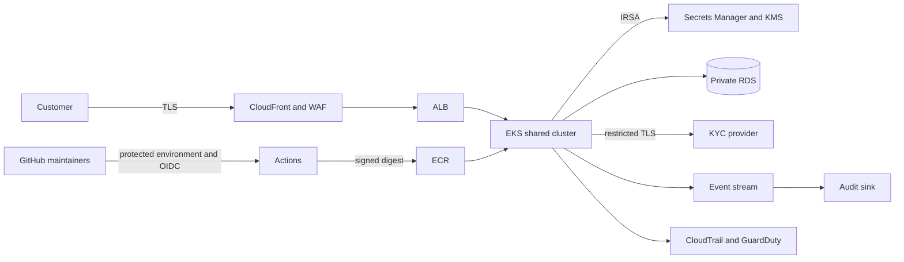

# Threat model

## Where the boundaries sit

## Five risks to spend time on

| Rank | How it starts and what is at risk | What this submission does |
|---|---|---|
| 1. Code execution in the API | An attacker reaches a vulnerable parser or dependency through the public API. They may read customer data, use the database login, or try to pivot from this shared cluster. | Run as non-root, remove host access, restrict the pod role and outbound traffic, and alert on shell execution. An exploit can still read data the API is authorized to handle. |
| 2. A release workflow is changed | A compromised maintainer changes source or CI and tries to publish an attacker-controlled image or assume AWS credentials. | Require reviewed changes, scope OIDC to the production environment, publish an immutable ECR tag, and sign and verify the image and its SBOM. |
| 3. A secret or customer detail leaks | A compromised process, debug path, or noisy exception exposes a DB/KYC credential or PII. | Deliver secrets from Secrets Manager, keep the pod role narrow, rotate credentials, and redact logs before serialization. In-process memory is still exposed to a process compromise. |
| 4. A neighboring workload is used to pivot | The cluster is shared with a dozen teams; a compromised pod tries host resources, Kubernetes secrets, or arbitrary network paths. | Reject host namespaces and mounts, give this service no Kubernetes API permissions, and deny unneeded traffic. A namespace is not a hard isolation boundary. |
| 5. Database exposure or missing evidence | A public database rule exposes account records, or incomplete audit logging makes an incident hard to reconstruct. | Keep RDS private, encrypt it, restrict ingress to the app security group, retain backups, and enable validated multi-region CloudTrail. |

**A risk I would not spend the first week on:** blocking every low-severity dependency finding. A package with no reachable vulnerable path should not have the same release impact as a leaked credential or an exploitable critical dependency. The workflow blocks critical and high findings and gives reviewed exceptions a hard expiry.

The T1–T5 labels used in the policies refer to the risks above. SBOM and audit retention also support provenance and incident review.
